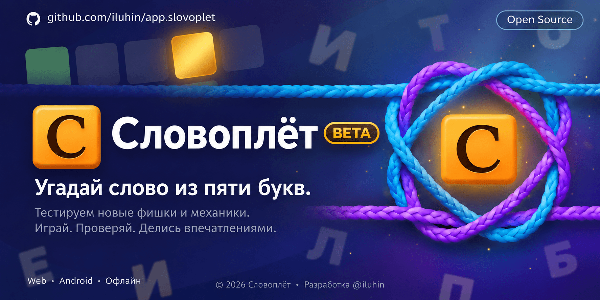
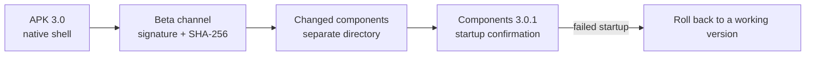

[Русский](README.md) · **English** · [Español](README.es.md) · [简体中文](README.zh-CN.md)

# Slovoplet · Beta

**Developing and testing updates to individual app components.**
Install the APK once and receive new versions of the web content through a dedicated beta channel.

[**Download APK 3.0 beta**](https://github.com/iluhin/app.slovoplet.beta/releases/download/beta-v3.0.0-r2/slovoplet-beta-3.0.apk) ·
[**Test the update**](docs/TESTING.md) ·
[**Beta guide**](wiki/Home.md) ·
[**Stable version**](https://github.com/iluhin/app.slovoplet/tree/main)

**Corrected build r2:** the application ID is com.iluhin.fiveletters.beta. Install APK 3.0 as a separate app; it cannot replace the old con package. The owner’s signing certificate is unchanged. [Details](docs/MIGRATION.md).

> This is the separate **Slovoplet Beta** repository, where we test updates to individual components.
> For everyday play, use the [stable release](https://github.com/iluhin/app.slovoplet/releases/latest).
> Automated checks have passed; testing on Android devices is awaiting feedback from testers.

## Current releases

| Part | Version | Purpose |
|---|---|---|
| Android shell | **3.0**, build `30000` | Install once to test OTA updates |
| Web components | **3.0.1**, revision `30001` | Receive inside 3.0 without installing another APK |
| Reference APK | **3.0.1**, build `30001` | Clean installation and comparison; not needed for the OTA test |
| Game baseline | **2.7.2** | The latest stable release when beta development began |

The beta app is named **“Словоплёт β”** and can be installed alongside the regular game.
Its application ID is `com.iluhin.fiveletters.beta`; it uses the project owner's existing signing certificate.

## First test: 3.0 → 3.0.1

The app's labels are in Russian; the steps below quote the labels you will see.

1. Install [APK 3.0 beta](https://github.com/iluhin/app.slovoplet.beta/releases/download/beta-v3.0.0-r2/slovoplet-beta-3.0.apk) and open the game with an internet connection.
2. Tap **“β · Готова 3.0.1”** (“β · 3.0.1 ready”) at the bottom. If needed, tap “Проверить обновления” (“Check for updates”).
3. Finish your round, then tap **“Применить без установки APK”** (“Apply without installing an APK”).
4. Check the result: **APK shell 3.0, components 3.0.1**, and the message “Проверка OTA пройдена” (“OTA check passed”).
5. Exit using the Android Back button from the home screen, disconnect from the internet, then reopen the game: components 3.0.1 should still be active.

**Do not install the reference APK 3.0.1 for this test.** Android settings will still show version 3.0:
the game content is updated while the installed shell keeps its version.
[Full test procedure, rollback and bug reporting →](docs/TESTING.md)

## How updates work

- HTML, JavaScript, CSS, images and bundled data can be updated; only changed files are downloaded.
- The 3.0 → 3.0.1 test downloads **one 152-byte component** and reuses nine files. The manifest is transferred separately.
- Downloading does not restart the current round. Apply the update using the button after a round, or on a fresh app launch.
- The manifest is signed with the owner's key, and the public key is pinned in the APK. Hashes, paths, sizes, version and compatibility are checked.
- Native code, permissions and the Android app icon require a new APK. Component update checks run while the app is open.

[Architecture and channel format →](wiki/Architecture.md) · [Checks and limitations →](docs/VERIFICATION.md)

## Beta development

The linked guides and technical documentation are currently in Russian.

| Section | Contents |
|---|---|
| [Beta changelog](CHANGELOG.md) | Changes to the shell and to components |
| [Roadmap](ROADMAP.md) | Completed work, pending checks and next tasks |
| [Beta migration](docs/MIGRATION.md) | Addresses, APK compatibility and preservation of signed files |
| [Release procedure](docs/RELEASING.md) | Preparing files, signing, publishing and verification |
| [OTA format](ota/README.md) | Signed manifests and components identified by SHA-256 |
| [Report a problem](CONTRIBUTING.md) | Versions and steps to include in a report |
| [Beta releases](releases/README.md) | Initial APK, reference APK and component archives |

This repository is the public channel for documentation and prepared beta builds.
The main source code for the website and Android app is kept in a separate private repository.
The workflow here verifies and publishes **prepared** files; it does not build or sign the app.

**beta-dist/** contains beta release files; **wiki/** contains this repository's guides.
**ota/** is the signed component channel for the corrected 3.0 / 3.0.1 builds.
Corrected APKs fetch updates directly from this repository:
[migrating from the old misspelled package](docs/MIGRATION.md).
Stable APKs and their history remain in the [main repository](https://github.com/iluhin/app.slovoplet).

Beta uses the same game server. The apps have separate local data, but signing in
with the same username opens the shared server profile. [Details →](wiki/FAQ.md#профиль-и-данные)

## Stable history

Beta is based on version 2.7.2. All stable releases and the detailed history of the app
and website are preserved in the [main repository](https://github.com/iluhin/app.slovoplet/blob/main/wiki/Versions.md).
Beta releases are listed [here](releases/README.md).

---

© Ilya Anisimov · [iluh.in](https://iluh.in) · [main / stable channel](https://github.com/iluhin/app.slovoplet/tree/main)
