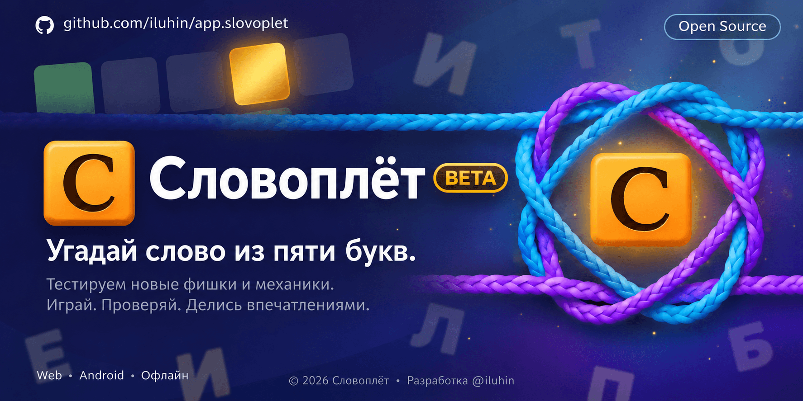
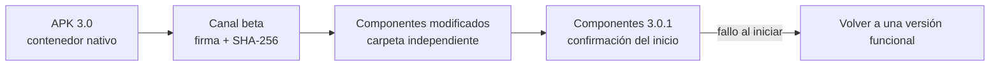

[Русский](README.md) · [English](README.en.md) · **Español** · [简体中文](README.zh-CN.md)

# Slovoplet · Beta

**Desarrollo y pruebas de actualizaciones de los componentes de la aplicación.**
Instala el APK una vez y recibe nuevas versiones de la parte web a través de un canal beta independiente.

[**Descargar APK 3.0 beta**](https://github.com/iluhin/app.slovoplet.beta/releases/download/beta-v3.0.0/slovoplet-beta-3.0.apk) ·
[**Probar la actualización**](docs/TESTING.md) ·
[**Guía de la beta**](wiki/Home.md) ·
[**Versión estable**](https://github.com/iluhin/app.slovoplet/tree/main)

> Este es el repositorio independiente de **Slovoplet Beta**, donde probamos las actualizaciones por componentes.
> Para jugar habitualmente, utiliza la [versión estable](https://github.com/iluhin/app.slovoplet/releases/latest).
> Las comprobaciones automáticas están completadas; las pruebas en dispositivos Android esperan los comentarios de quienes prueban la beta.

## Versiones publicadas

| Parte | Versión | Finalidad |
|---|---|---|
| Contenedor nativo de Android | **3.0**, compilación `30000` | Instalar una vez para probar las actualizaciones OTA |
| Componentes web | **3.0.1**, revisión `30001` | Recibir dentro de la versión 3.0 sin instalar otro APK |
| APK de referencia | **3.0.1**, compilación `30001` | Instalación limpia y comparación; no es necesario para la prueba OTA |
| Versión de partida del juego | **2.7.2** | Última versión estable cuando comenzó el desarrollo de la beta |

La aplicación beta se llama **«Словоплёт β»** y se puede instalar junto al juego habitual.
Su identificador es `con.iluhin.fiveletters.beta`; utiliza el certificado de firma del propietario del proyecto.

## Primera prueba: 3.0 → 3.0.1

Los botones de la aplicación están en ruso; estos pasos conservan sus nombres para que puedas identificarlos.

1. Instala el [APK 3.0 beta](https://github.com/iluhin/app.slovoplet.beta/releases/download/beta-v3.0.0/slovoplet-beta-3.0.apk) y abre el juego con conexión a Internet.
2. Pulsa **«β · Готова 3.0.1»** («β · 3.0.1 lista») en la parte inferior. Si hace falta, pulsa «Проверить обновления» («Buscar actualizaciones»).
3. Termina la partida y pulsa **«Применить без установки APK»** («Aplicar sin instalar un APK»).
4. Comprueba el resultado: **contenedor APK 3.0, componentes 3.0.1** y el mensaje «Проверка OTA пройдена» («Comprobación OTA superada»).
5. Sal con el botón Atrás de Android desde la pantalla principal, desconecta Internet y vuelve a abrir el juego: los componentes 3.0.1 deben seguir activos.

**No instales el APK de referencia 3.0.1 para esta prueba.** Los ajustes de Android seguirán mostrando
la versión 3.0: se actualiza el contenido del juego y el contenedor instalado conserva su versión.
[Procedimiento completo, reversión e informe de errores →](docs/TESTING.md)

## Cómo funcionan las actualizaciones

- Se pueden actualizar HTML, JavaScript, CSS, imágenes y datos incluidos; solo se descargan los archivos modificados.
- La prueba 3.0 → 3.0.1 descarga **un componente de 152 bytes** y reutiliza nueve archivos. El manifiesto se transfiere por separado.
- La descarga no reinicia la partida en curso. La actualización se aplica con el botón después de la partida o al iniciar de nuevo la aplicación.
- El manifiesto está firmado con la clave del propietario y la clave pública está fijada en el APK. Se comprueban los hashes, las rutas, los tamaños, la versión y la compatibilidad.
- El código nativo, los permisos y el icono de Android requieren un nuevo APK. Las comprobaciones de componentes funcionan mientras la aplicación está abierta.

[Arquitectura y formato del canal →](wiki/Architecture.md) · [Comprobaciones y limitaciones →](docs/VERIFICATION.md)

## Desarrollo de la beta

Las guías y la documentación técnica enlazadas están actualmente en ruso.

| Sección | Contenido |
|---|---|
| [Historial de la beta](CHANGELOG.md) | Cambios del contenedor y de los componentes |
| [Plan de desarrollo](ROADMAP.md) | Trabajo completado, comprobaciones pendientes y próximas tareas |
| [Migración de la beta](docs/MIGRATION.md) | Direcciones, compatibilidad de los APK y conservación de los archivos firmados |
| [Procedimiento de publicación](docs/RELEASING.md) | Preparación, firma, publicación y verificación de los archivos |
| [Formato OTA](ota/README.md) | Manifiesto firmado y componentes identificados por SHA-256 |
| [Informar de un problema](CONTRIBUTING.md) | Versiones y pasos que debe incluir el informe |
| [Versiones beta](releases/README.md) | APK inicial, APK de referencia y archivos de componentes |

Este repositorio es el canal público de documentación y compilaciones beta preparadas.
El código fuente principal del sitio y de la aplicación Android se guarda en otro repositorio privado.
El workflow de este repositorio comprueba y publica archivos **ya preparados**; no compila ni firma la aplicación.

**beta-dist/** contiene los archivos de los lanzamientos beta; **wiki/** contiene las guías de este repositorio.
**ota/** es una copia exacta de los componentes firmados de 3.0 / 3.0.1.
Los APK ya publicados los obtienen de la dirección original conservada:
[detalles de la migración](docs/MIGRATION.md).
Los APK estables y su historial permanecen en el [repositorio principal](https://github.com/iluhin/app.slovoplet).

La beta utiliza el mismo servidor de juego. Las aplicaciones tienen datos locales separados,
pero iniciar sesión con el mismo nombre abre el perfil compartido del servidor. [Más información →](wiki/FAQ.md#профиль-и-данные)

## Historial estable

La beta parte de la versión 2.7.2. Todos los lanzamientos estables y el historial detallado
del juego y del sitio se conservan en el [repositorio principal](https://github.com/iluhin/app.slovoplet/blob/main/wiki/Versions.md).
Los lanzamientos beta están [aquí](releases/README.md).

---

© Ilya Anisimov · [iluh.in](https://iluh.in) · [main / canal estable](https://github.com/iluhin/app.slovoplet/tree/main)
