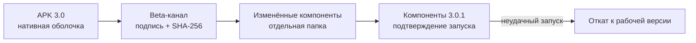

**Русский** · [English](README.en.md) · [Español](README.es.md) · [简体中文](README.zh-CN.md)

# Словоплёт · Beta

**Разработка и проверка обновлений приложения по компонентам.**
Одна установка APK — новые версии веб-части из отдельного beta-канала.

[**Скачать APK 3.0 beta**](https://github.com/iluhin/app.slovoplet.beta/releases/download/beta-v3.0.0/slovoplet-beta-3.0.apk) ·
[**Проверить обновление**](docs/TESTING.md) ·
[**Справка beta**](wiki/Home.md) ·
[**Стабильная версия**](https://github.com/iluhin/app.slovoplet/tree/main)

> Вы в отдельном репозитории **Словоплёт Beta**. Здесь проверяем механизм обновления компонентов.
> Для обычной игры используйте [стабильный выпуск](https://github.com/iluhin/app.slovoplet/releases/latest).
> Результаты автоматических проверок готовы; проверка на Android-устройстве ждёт обратной связи тестировщиков.

## Что сейчас выпущено

| Часть | Версия | Назначение |
|---|---|---|
| Оболочка Android | **3.0**, сборка `30000` | Установить один раз для проверки OTA |
| Веб-компоненты | **3.0.1**, ревизия `30001` | Получить внутри 3.0 без установки нового APK |
| Контрольный APK | **3.0.1**, сборка `30001` | Чистая установка и сверка; для теста OTA не нужен |
| Основа игры | **2.7.2** | Последний стабильный релиз, от которого начата beta |

Beta-приложение называется **«Словоплёт β»** и устанавливается рядом с обычной игрой.
Идентификатор — `con.iluhin.fiveletters.beta`, сертификат подписи — прежний, владельца проекта.

## Первый тест: 3.0 → 3.0.1

1. Установите [APK 3.0 beta](https://github.com/iluhin/app.slovoplet.beta/releases/download/beta-v3.0.0/slovoplet-beta-3.0.apk) и откройте игру с интернетом.
2. Нажмите **«β · Готова 3.0.1»** внизу. Если нужно — «Проверить обновления».
3. Завершите партию и нажмите **«Применить без установки APK»**.
4. Проверьте результат: **оболочка APK 3.0, компоненты 3.0.1** и сообщение «Проверка OTA пройдена».
5. Выйдите кнопкой «Назад» с главной, отключите сеть и снова откройте игру: компоненты 3.0.1 должны сохраниться.

**Не устанавливайте контрольный APK 3.0.1 для этого теста.** Версия в настройках Android
останется 3.0: обновляется содержимое игры, а установленная оболочка остаётся прежней.
[Полный сценарий, откат и отчёт об ошибке →](docs/TESTING.md)

## Как устроено обновление

- Меняются HTML, JavaScript, CSS, изображения и встроенные данные; скачиваются только изменённые файлы.
- В тесте 3.0 → 3.0.1 загружается **один компонент на 152 байта**, девять файлов используются повторно. Манифест передаётся отдельно.
- Загрузка не перезапускает текущую партию. Применение — по кнопке после партии либо при новом запуске приложения.
- Манифест подписан ключом владельца, открытый ключ закреплён в APK. Проверяются хеши, пути, размеры, версия и совместимость.
- Нативный код, разрешения и иконка Android обновляются новым APK. Проверка компонентов работает, пока приложение запущено.

[Архитектура и формат канала →](wiki/Architecture.md) · [Проверки и ограничения →](docs/VERIFICATION.md)

## Разработка beta

| Раздел | Что в нём |
|---|---|
| [История beta](CHANGELOG.md) | Что относится к оболочке, а что — к компонентам |
| [План развития](ROADMAP.md) | Сделано, ожидает проверки, следующие задачи |
| [Перенос beta](docs/MIGRATION.md) | Адреса, совместимость APK и сохранение подписанных файлов |
| [Порядок выпуска](docs/RELEASING.md) | Подготовка файлов, подпись, публикация и проверка |
| [Формат OTA](ota/README.md) | Подписанный манифест и компоненты по SHA-256 |
| [Сообщить о проблеме](CONTRIBUTING.md) | Какие версии и шаги указать в отчёте |
| [Beta-релизы](releases/README.md) | Установочный APK, контрольный APK и архивы компонентов |

Репозиторий — публичный канал документации и готовых beta-сборок. Основной исходный код сайта
и Android-приложения хранится в отдельном закрытом репозитории. Workflow здесь
проверяет и публикует **подготовленные** файлы, не собирает и не подписывает приложение.

**beta-dist/** — файлы beta-релизов; **wiki/** — справка этого репозитория.
**ota/** — точная копия подписанных компонентов 3.0 / 3.0.1.
Уже выпущенные APK получают их по сохранённому прежнему адресу:
[как устроен перенос](docs/MIGRATION.md).
Стабильные APK и история остаются в [основном репозитории](https://github.com/iluhin/app.slovoplet).

Beta использует тот же игровой сервер. Локальные данные приложений разделены,
но вход под тем же именем открывает общий серверный профиль. [Подробнее →](wiki/FAQ.md#профиль-и-данные)

## Стабильная история

Основа beta — версия 2.7.2. Все стабильные выпуски и подробная история приложения
и сайта сохранены в [основном репозитории](https://github.com/iluhin/app.slovoplet/blob/main/wiki/Versions.md).
Beta-релизы находятся [здесь](releases/README.md).

---

© Илья Анисимов · [iluh.in](https://iluh.in) · [main / стабильный канал](https://github.com/iluhin/app.slovoplet/tree/main)
