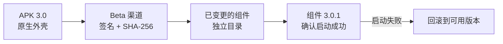

[Русский](README.md) · [English](README.en.md) · [Español](README.es.md) · **简体中文**

# Slovoplet · Beta

**开发和测试应用组件更新。**
安装一次 APK，即可通过独立的 beta 渠道获取网页版游戏组件的新版本。

[**下载 APK 3.0 beta**](https://github.com/iluhin/app.slovoplet.beta/releases/download/beta-v3.0.0/slovoplet-beta-3.0.apk) ·
[**测试更新**](docs/TESTING.md) ·
[**Beta 指南**](wiki/Home.md) ·
[**稳定版**](https://github.com/iluhin/app.slovoplet/tree/main)

> 这里是独立的 **Slovoplet Beta** 仓库，用于测试应用组件更新机制。
> 日常游玩请使用[稳定版](https://github.com/iluhin/app.slovoplet/releases/latest)。
> 自动检查已完成；Android 实机测试仍在等待测试者反馈。

## 已发布版本

| 部分 | 版本 | 用途 |
|---|---|---|
| Android 原生外壳 | **3.0**，构建号 `30000` | 安装一次，用于测试 OTA 更新 |
| Web 组件 | **3.0.1**，修订号 `30001` | 在 3.0 内接收，无需安装新的 APK |
| 参考 APK | **3.0.1**，构建号 `30001` | 用于全新安装和对比；OTA 测试不需要此文件 |
| 游戏基础版本 | **2.7.2** | beta 开发开始时的最新稳定版 |

Beta 应用名为 **“Словоплёт β”**，可以与常规版游戏同时安装。
应用 ID 为 `con.iluhin.fiveletters.beta`，使用项目所有者原有的签名证书。

## 首次测试：3.0 → 3.0.1

应用按钮为俄语，以下步骤保留了实际显示的文字，便于查找。

1. 安装 [APK 3.0 beta](https://github.com/iluhin/app.slovoplet.beta/releases/download/beta-v3.0.0/slovoplet-beta-3.0.apk)，联网打开游戏。
2. 点击底部的 **“β · Готова 3.0.1”**（“β · 3.0.1 已就绪”）。如有需要，点击“Проверить обновления”（“检查更新”）。
3. 完成本局后，点击 **“Применить без установки APK”**（“无需安装 APK，直接应用”）。
4. 确认结果：**APK 外壳 3.0、组件 3.0.1**，并显示“Проверка OTA пройдена”（“OTA 检查通过”）。
5. 在游戏主界面按 Android 返回键退出，断开网络后重新打开游戏：组件 3.0.1 应继续生效。

**进行此项测试时，请勿安装参考 APK 3.0.1。** Android 设置中显示的版本仍为 3.0：
更新的是游戏内容，已安装的原生外壳版本保持不变。
[完整测试步骤、回滚与问题报告 →](docs/TESTING.md)

## 更新机制

- 可更新 HTML、JavaScript、CSS、图片和内置数据；仅下载已变更的文件。
- 在 3.0 → 3.0.1 测试中，下载**一个 152 字节的组件**，复用另外九个文件。清单单独传输。
- 下载不会重启正在进行的游戏。可在本局结束后点击按钮应用更新，或在下次重新启动应用时应用。
- 清单由所有者的密钥签名，公钥固定在 APK 中。加载器会检查哈希、路径、大小、版本和兼容性。
- 原生代码、权限和 Android 应用图标的变更需要新的 APK。组件更新检查仅在应用运行时进行。

[架构与渠道格式 →](wiki/Architecture.md) · [检查结果与限制 →](docs/VERIFICATION.md)

## Beta 开发

以下链接中的指南和技术文档目前使用俄语。

| 章节 | 内容 |
|---|---|
| [Beta 更新记录](CHANGELOG.md) | 原生外壳和组件各自的变更 |
| [开发计划](ROADMAP.md) | 已完成工作、待验证项目和后续任务 |
| [Beta 迁移说明](docs/MIGRATION.md) | 地址、APK 兼容性及签名文件的保留方式 |
| [发布流程](docs/RELEASING.md) | 文件准备、签名、发布和验证 |
| [OTA 格式](ota/README.md) | 签名清单及以 SHA-256 标识的组件 |
| [报告问题](CONTRIBUTING.md) | 报告中应包含的版本和复现步骤 |
| [Beta 发布版本](releases/README.md) | 初始 APK、参考 APK 和组件压缩包 |

本仓库是文档和已准备好的 beta 构建的公开发布渠道。
网站及 Android 应用的主要源代码保存在另一个私有仓库。
这里的 workflow 检查并发布**已准备好的**文件，不负责编译或签名应用。

**beta-dist/** 存放 beta 发布文件；**wiki/** 存放本仓库的指南。
**ota/** 是 3.0 / 3.0.1 签名组件的完整副本。
已经发布的 APK 仍从保留的原地址获取组件：
[迁移机制说明](docs/MIGRATION.md)。
稳定版 APK 及其历史记录保留在[主仓库](https://github.com/iluhin/app.slovoplet)。

Beta 与常规版使用同一个游戏服务器。应用的本地数据相互独立，
但使用相同用户名登录时，会打开同一个服务器个人资料。[详细说明 →](wiki/FAQ.md#профиль-и-данные)

## 稳定版历史

Beta 以 2.7.2 为基础。所有稳定版发布记录以及游戏和网站的详细开发历史，
均保留在[主仓库](https://github.com/iluhin/app.slovoplet/blob/main/wiki/Versions.md)。
Beta 发布版本请见[这里](releases/README.md)。

---

© Ilya Anisimov · [iluh.in](https://iluh.in) · [main / 稳定渠道](https://github.com/iluhin/app.slovoplet/tree/main)
