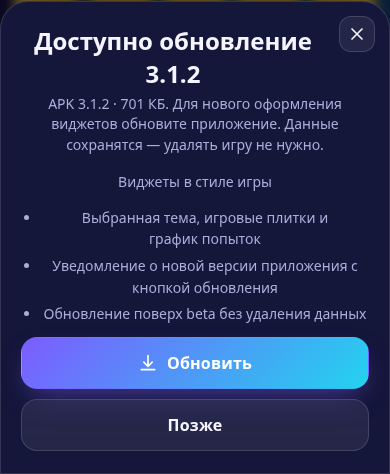

# Проверка beta 3.1.2

[Главная](../README.md) · [Виджеты](WIDGETS.md) · [Отчёт](../CONTRIBUTING.md)

## OTA и уведомление о новом APK

1. Оставьте установленную рабочую beta 3.1.1 (либо исправленную 3.0/3.0.1 r2).
   Пакет — com.iluhin.fiveletters.beta. Пока не ставьте APK 3.1.2.
2. Откройте beta → «Проверить обновления», загрузите компоненты 3.1.2.
3. Завершите начатую партию и примените компоненты. Оболочка остаётся прежней,
   компоненты становятся 3.1.2. Установщик Android не появляется.
4. На свободном экране игры должно появиться окно «Доступно обновление 3.1.2»
   с описанием и кнопкой «Обновить». Оно относится к APK, поэтому появляется
   даже при уже актуальных компонентах 3.1.2.
5. Нажмите «Обновить»: браузер открывает APK именно из beta-выпуска этого
   репозитория. Android предлагает обычную установку поверх приложения.
6. Либо нажмите «Позже» и проверьте ручную проверку APK в окне beta.
   Отсрочка относится к предложенной версии, а не ко всем будущим обновлениям.
7. Установите APK 3.1.2 поверх beta, без удаления и очистки данных. Оболочка
   и компоненты показывают 3.1.2. После нового запуска предложения той же версии нет.

Во время незаконченной партии уведомление не перекрывает поле и не сбрасывает
ввод. Откройте главную после завершения партии и проверьте предложение обновления.
При установке из магазина обновляет магазин; обычный стабильный механизм сохранён.

## Виджеты после установки APK

[Инструкция](WIDGETS.md). Проверьте четыре варианта, компактный и широкий размеры,
светлую и тёмную темы игры, нулевую статистику и сохранённые данные без сети.
В статистике попытки должны быть графиком; быстрый старт — с заметной кнопкой;
рейтинг — строками; слово дня — со статусом и отсчётом по Москве.

Нажатие «Продолжить» сохраняет текущую партию и частичный ввод. Выключенное
администратором слово дня остаётся недоступным; виджет объясняет это и позволяет
перейти к обычной игре.

## Если ещё установлен падающий APK 3.1

Сразу установите [APK 3.1.2](https://github.com/iluhin/app.slovoplet.beta/releases/download/beta-v3.1.2/slovoplet-beta-3.1.2.apk)
поверх него. В нём сохранено исправление вылета из 3.1.1.
Не удаляйте приложение и не очищайте данные.

## Что прислать

Модель телефона, Android, лаунчер, версии оболочки/компонентов, выбранную тему,
шаги и результат. Полезны скриншоты предложения APK и виджетов.
[Шаблон отчёта](../CONTRIBUTING.md).

## Пример окна обновления

