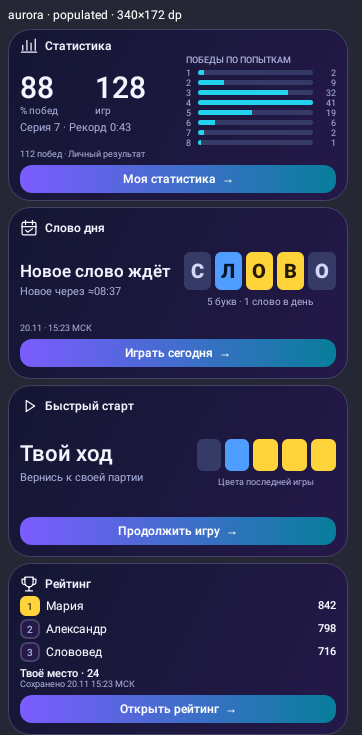
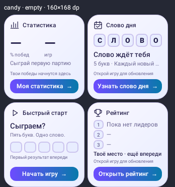

# Виджеты и шорткаты beta 3.1.2

[Главная](../README.md) · [Проверка OTA](TESTING.md) · [Проверки](VERIFICATION.md)

## Что нужно установить

Компоненты 3.1.2 приходят по OTA в исправленные APK 3.0 / 3.0.1, но Android-виджеты
и динамические шорткаты требуют нативного APK 3.1. Установите его поверх
com.iluhin.fiveletters.beta: ключ тот же, удалять приложение не требуется.
Не путайте со старым ошибочным con-пакетом.

После первого запуска откройте игру, чтобы записался снимок. Долгое нажатие
на свободном месте рабочего стола → «Виджеты» → «Словоплёт β».
Добавьте один из четырёх вариантов.

| Виджет | Данные и действия |
|---|---|
| Статистика | Игры, победы и их процент, серия, рекорд. Расширьте до 4×2 для распределения попыток. |
| Слово дня | Доступность, дата сыгранного дня, приблизительное время до нового дня по Europe/Moscow. |
| Быстрый старт | Крупное действие новой игры/продолжения и пять цветных плиток последнего результата. Букв и загаданного слова нет. |
| Рейтинг | Три лидера, ваше место, когда оно присутствует в ответе сервера, и дата снимка. |

Сервер отдаёт ограниченный список лидеров: если вашего места в нём нет,
виджет честно показывает, что оно неизвестно. Для автономных партий статистика
отмечается отдельно, онлайн-рейтинг от них не меняется.

## Оформление 3.1.2

Виджеты используют выбранную в игре тему: Aurora, Midnight, Matcha, Sunset,
Candy или Contrast. Откройте игру после смены темы, чтобы сохранить снимок.
Игровые плитки, обводки, иконки и основные кнопки повторяют язык интерфейса игры.

У каждого типа собственные компактная и широкая композиции. Расширьте статистику
для графика побед по попыткам. В быстром старте заметное действие «Начать» или
«Продолжить»; цвета результата показываются без букв и без раскрытия слова.
В рейтинге лидеры представлены отдельными строками, а снимок подписан датой.
Недоступное слово дня не выдаётся за доступную сегодняшнюю партию.

## Шорткаты

На Android 7.1+ удерживайте иконку приложения:
«Новая игра»/«Продолжить игру», доступное несыгранное «Слово дня»,
«Рейтинг», «Мой профиль». Список динамический, максимум четыре пункта.
На Android 7.0 виджеты работают, а динамических шорткатов ещё нет.
Лаунчер должен поддерживать такие пункты.

Нажатие с новой игрой не должно терять незавершённую партию: игра продолжает
её. Переходы работают и при холодном запуске, и в уже открытом приложении.

## Сеть, время и батарея

У существующих API state/leaderboard есть побочный эффект — они отмечают
присутствие игрока. Поэтому beta не опрашивает их при закрытой игре.
Снимок обновляется во время настоящего использования приложения, рейтинг —
с ограничением дополнительных запросов раз в 30 минут.

Android примерно раз в 30 минут перерисовывает сохранённый снимок.
Система может задерживать такие обновления. Дневной отсчёт приблизительный,
рядом есть время его расчёта. Завершённый день подписан датой, чтобы старые
данные не выдавались за сегодняшние. Часовой пояс игры — Europe/Moscow,
независимо от часового пояса телефона.

Фоновой службы, точных будильников и новых разрешений нет.
Для фонового свежего рейтинга в будущем понадобится отдельный серверный API,
который не считает такой запрос посещением.

## Проверить на телефоне

1. Добавить четыре виджета, в том числе без сети.
2. Сыграть партию: статистика и цвета обновились; виджет не раскрывает слово.
3. Увеличить статистику до 4×2 и проверить попытки.
4. Проверить каждый шорткат и сохранность незаконченной партии.
5. Проверить слово дня в московскую полночь при другом часовом поясе устройства.
6. Проверить светлую/тёмную тему, смену размера и поведение выбранного лаунчера.
7. Проверить расход батареи в течение суток.

Эти проверки требуют настоящего Android/лаунчера. Автоматические проверки
снимка, ресурсов и браузерного моста не подменяют их.

## Примеры оформления

Ниже тестовые данные, отрисованные настоящими Android RemoteViews на Canvas:
это примеры оформления, а не результаты профиля владельца.

[Протокол проверки](VERIFICATION.md). Размещение в реальном лаунчере может отличаться.
